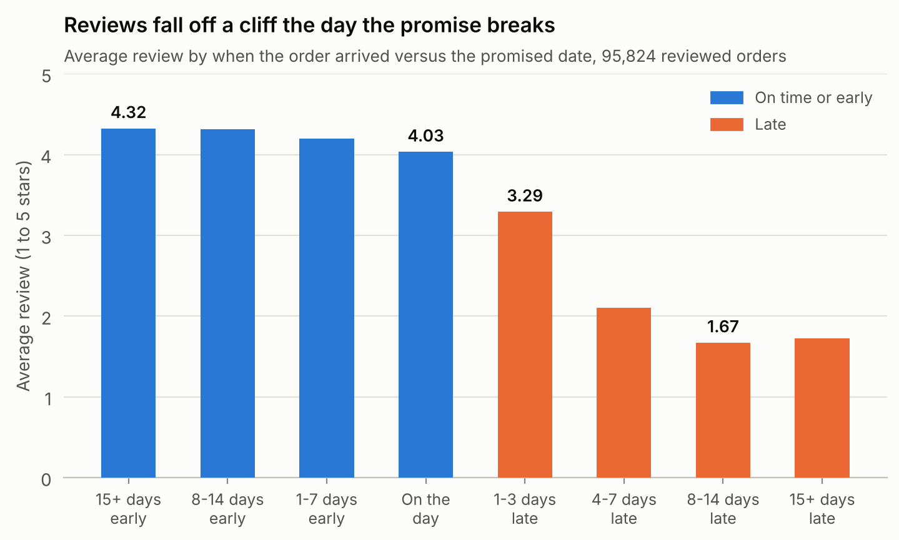
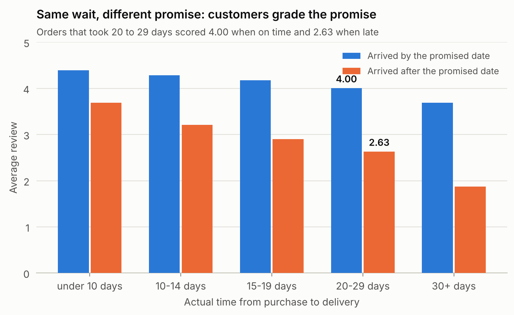
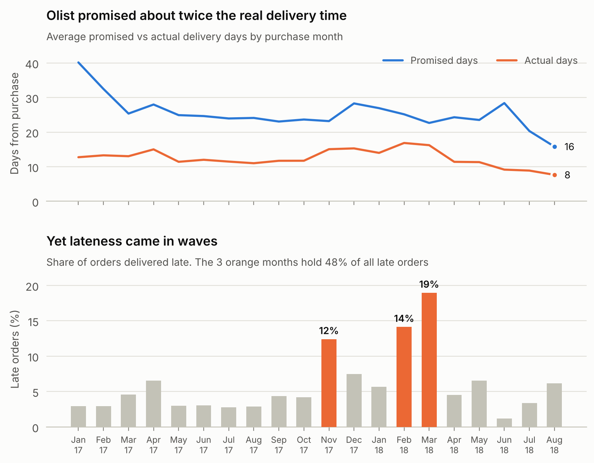
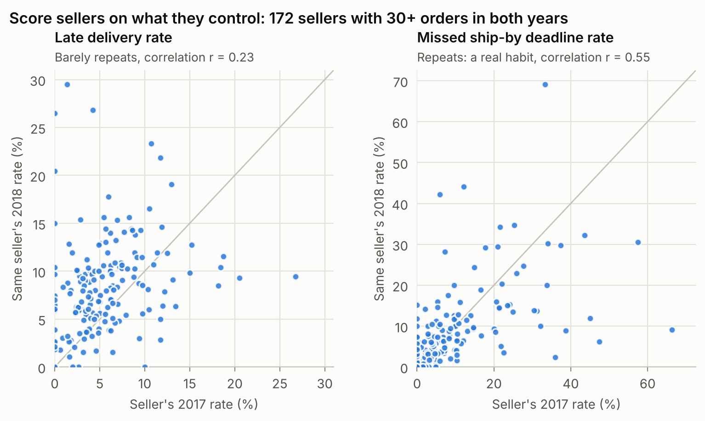
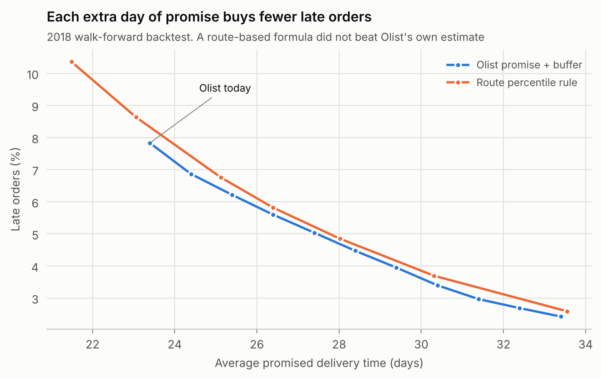

# Broken Promises: What Late Deliveries Cost an Online Marketplace


**[Open the live dashboard](https://nobrainercodes.github.io/ecommerce-delivery-analytics/)** · [Read the 1-page memo](reports/memo.md) · [See the SQL](sql/)

Olist is a Brazilian online marketplace that connects small sellers to big shopping sites. I analyzed **96,470 delivered orders** (Sept 2016 to Aug 2018) to answer one business question:

> **What drives bad reviews, and what should Olist fix first?**

## The short version

1. **Late orders were 6.8% of deliveries but drew 37% of all 1-star reviews.** On-time orders averaged 4.29 stars. Late orders averaged 2.27.
2. **Customers grade the promise, not the wait.** At the same delivery time, a late order lost **1.38 stars**. Each extra day of waiting, while still on time, cost only 0.03 stars. So breaking the promise hurt as much as about **47 extra days** of waiting.
3. **Lateness came in waves and mostly sat with the carrier.** Three months held 48% of all late orders. Late orders spent about 28 days with the carrier versus 8 days for on-time orders.
4. **A seller's late rate is mostly luck. Missing the ship-by deadline is a habit.** Year over year, seller late rates barely repeated (r = 0.23). Missing the ship-by deadline did repeat (r = 0.55), and it made an order 3.8 times more likely to be late.

### What I would tell Olist to do

| # | Recommendation | Impact over the 2 years of data |
|---|---|---|
| 1 | **Score sellers on the ship-by deadline**, not on late deliveries | **811 fewer late orders** (12%) if every seller had shipped on time |
| 2 | **Add 5 days to the promise during the holiday rush** (Nov 20 to Dec 31) | **450 fewer late orders** in 2017. The same cost spread over the whole year saves only 347 |
| 3 | **Pick the everyday buffer on purpose** | Each extra promised day cuts the late rate by about **0.7 points** (2018: 7.7% at +0 days, 5.5% at +3) |

Together, the first two would have prevented about **1,223 late orders (19%)** and about **570 one-star reviews**.

## The charts

**1. Reviews fall off a cliff the day the promise breaks.** Scores stay above 4 for every early bucket, even "on the day". One day late drops them to 3.29.



**2. Same wait, different promise.** Orders that took 20 to 29 days scored 4.00 when they beat the promise and 2.63 when they missed it.



**3. Olist promised about twice the real delivery time, yet lateness still came in waves.** The promise averaged 24.4 days. Actual delivery averaged 12.5. But in Nov 2017, Feb 2018 and Mar 2018, late rates jumped to 12% to 19%.



**4. Score sellers on what they control.** Each dot is one of 172 sellers with 30+ orders in both years. A seller's late rate in 2017 said little about 2018. Their habit of missing the ship-by deadline carried over.



**5. What a longer promise buys.** Adding days to every 2018 promise cuts late orders, but with less payoff each day. A smarter route-based formula did not beat Olist's own estimate.



## How I did it

**1. Built a small data warehouse in SQL (DuckDB).** Eight raw tables go into typed [staging tables](sql/01_staging.sql), then into an [order-level fact table](sql/02_marts.sql) with every delivery and review metric. Window functions handle things like picking the latest review per order and numbering each customer's orders.

**2. Answered each question with a SQL query.** There are [12 analysis queries](sql/analysis/). They use CTEs, window functions (`row_number`, `rank`, running totals), `FILTER` clauses and `generate_series` to test what-if scenarios on every order at once. For example, [11_buffer_tradeoff.sql](sql/analysis/11_buffer_tradeoff.sql) checks all 52,777 orders from 2018 against 11 different promise buffers in one query.

**3. Tested the big claims with statistics** ([src/models.py](src/models.py)).
- *Promise vs wait:* a regression of review score on a late flag and delivery days, with controls for customer state, purchase month and order value, and robust standard errors. Late penalty: 1.38 stars (95% CI: 1.33 to 1.43). When I let every delivery day have its own effect instead of a straight line, the penalty was still 1.25 stars.
- *Seller habits:* year-over-year correlations with 95% confidence intervals (late rate r = 0.23, CI 0.09 to 0.37; ship-by r = 0.55, CI 0.43 to 0.64).
- *Seller handoff:* a what-if that moves each late handoff back to the deadline and keeps the carrier time the same.
- *Promise formulas:* a walk-forward backtest on 2018. Each month the formula only sees orders that were already delivered before that month, so there is no peeking at the future.

**4. Sized the impact in reviews**, using the gap in 1-star rates between late (54%) and on-time (7%) orders.

**5. Built an [interactive dashboard](https://nobrainercodes.github.io/ecommerce-delivery-analytics/)** with filters by state and year and a promise simulator. It is a single static page with hand-built SVG charts, hosted free on GitHub Pages.

## What did not work (and why that matters)

I tested a few ideas that sounded right but did not hold up. I kept them in because they changed the recommendations.

- **"Late deliveries stop customers from coming back."** Raw numbers said yes: 1.6% of customers with a late first order bought again within 180 days, versus 2.0% for on-time. But after controlling for state, month and order value, the gap was only 0.24 points and not statistically significant (p = 0.28). Repeat buying is rare for everyone. The real cost shows up in reviews.
- **"A smarter promise formula will fix it."** I built a route-based rule (promise = a high percentile of past delivery times for each seller-state to customer-state route). To hit a 5% late rate it needed 27.8 promised days on average. Olist's own estimate plus a flat buffer needed 27.5. So the lever is the size of the buffer, not a new formula.
- **"Rank sellers by late rate and punish the worst ones."** Late rates barely repeat from one year to the next, so this would mostly punish bad luck and carrier problems. That is why recommendation 1 uses the ship-by deadline instead.

## Run it yourself

You need Python 3.10 or newer. Everything runs locally in about a minute. No database server or API keys.

```bash
git clone https://github.com/nobrainerCODES/ecommerce-delivery-analytics.git
cd ecommerce-delivery-analytics
python3 -m venv .venv && source .venv/bin/activate
pip install -r requirements.txt
python run_pipeline.py   # raw data -> warehouse -> SQL -> models -> charts -> dashboard
pytest                   # data checks, and checks that this README matches the numbers
open docs/index.html     # the dashboard (use xdg-open on Linux)
```

GitHub Actions runs the full pipeline and the tests on every push.

## Repo map

```
├── data/raw/              Olist CSVs, gzipped (see data/README.md for source, license and quality notes)
├── sql/
│   ├── 01_staging.sql     raw CSVs -> typed, cleaned staging tables
│   ├── 02_marts.sql       fct_orders, dim_customers, dim_sellers
│   └── analysis/          12 queries, one per question
├── src/
│   ├── build_warehouse.py runs the SQL build
│   ├── run_sql_analysis.py runs every analysis query -> outputs/sql/*.csv
│   ├── models.py          regressions, correlations, backtest, sizing -> outputs/metrics.json
│   ├── charts.py          README charts -> reports/figures/
│   └── build_dashboard.py dashboard data -> docs/data.js
├── docs/index.html        the live dashboard (GitHub Pages)
├── reports/memo.md        1-page recommendation memo
├── tests/                 pytest checks
└── run_pipeline.py        runs everything in order
```

## Definitions

- **Delivered order:** status is "delivered" and there is a delivery date (96,470 orders).
- **Late:** delivered on a calendar day after the promised date shown to the customer. The promise has no time of day, so this is the fairest cut.
- **Ship-by deadline:** the date by which the seller must hand the package to the carrier. Olist sets it for every item.
- **Repeat purchase:** another order (not canceled) 1 to 180 days after a customer's first order. Only first orders from Jan 2017 to Feb 2018 count, so everyone gets a full 180 days.

## Limits

- This is observational data. The review effect is a strong pattern with controls, not a controlled experiment. A real test would be an A/B test of the promise date or of proactive delay messages.
- The data cannot show what a longer promise costs at checkout. A longer promise could lose some sales. That is why recommendation 3 is a choice for Olist to make, not a fixed number.
- The seller handoff what-if assumes the carrier would take the same time if the seller had shipped on time.
- The data ends in Aug 2018, so 2017 is the only holiday season in it.

## Data and credits

Data: [Brazilian E-Commerce Public Dataset by Olist](https://www.kaggle.com/datasets/olistbr/brazilian-ecommerce), CC BY-NC-SA 4.0. Code: MIT.

Built by **Shraman Pandey**, Business Analytics and Information Systems (BAIS) student at Penn State Smeal College of Business.
